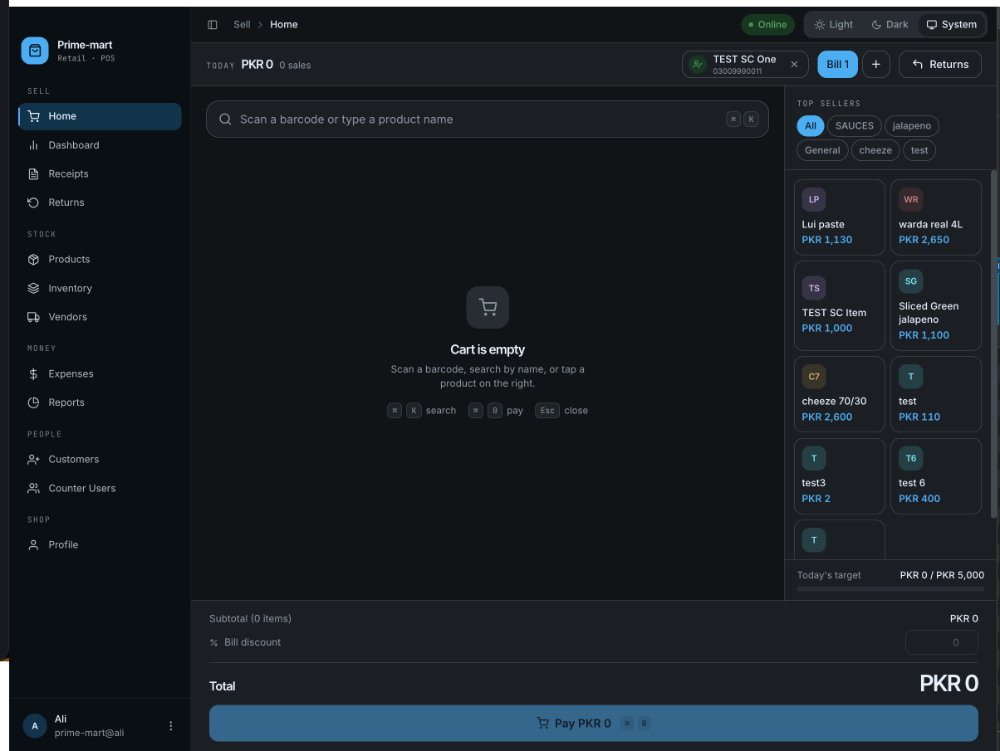
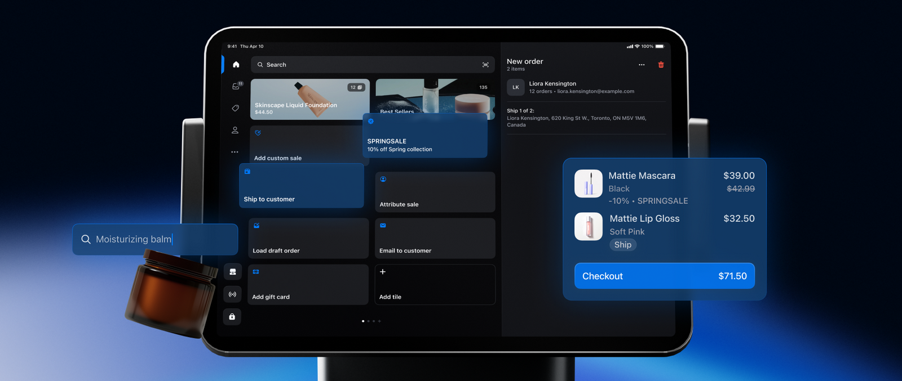
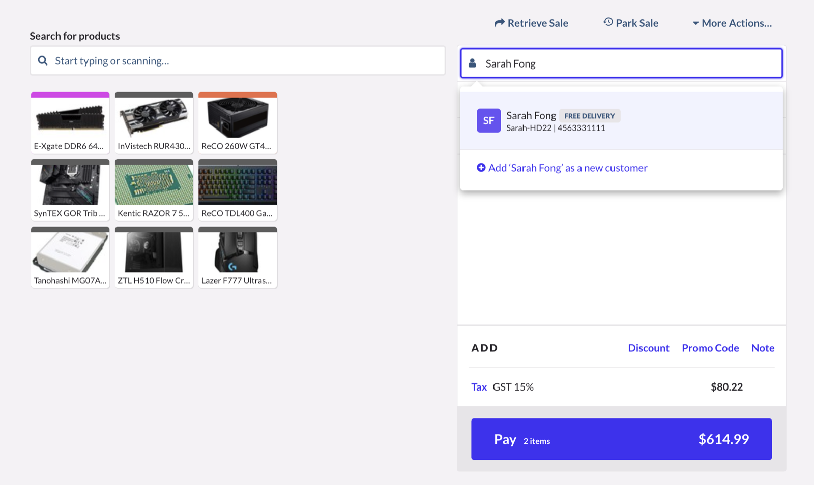
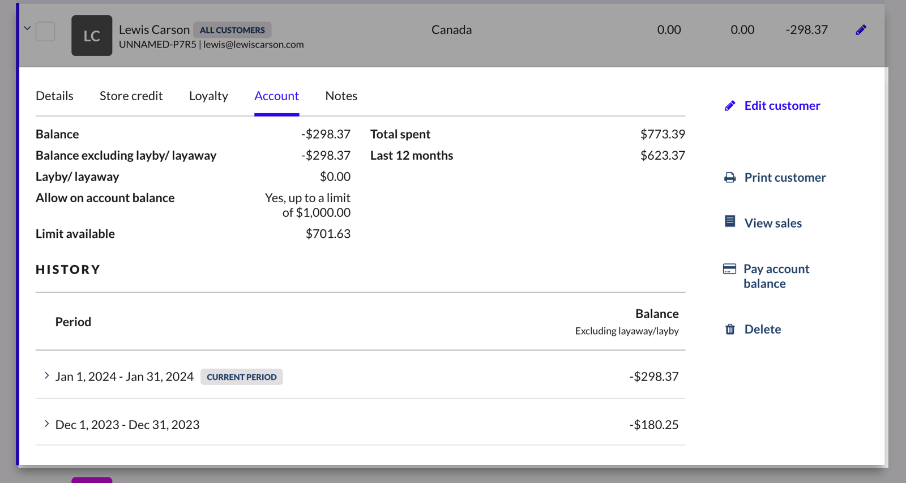
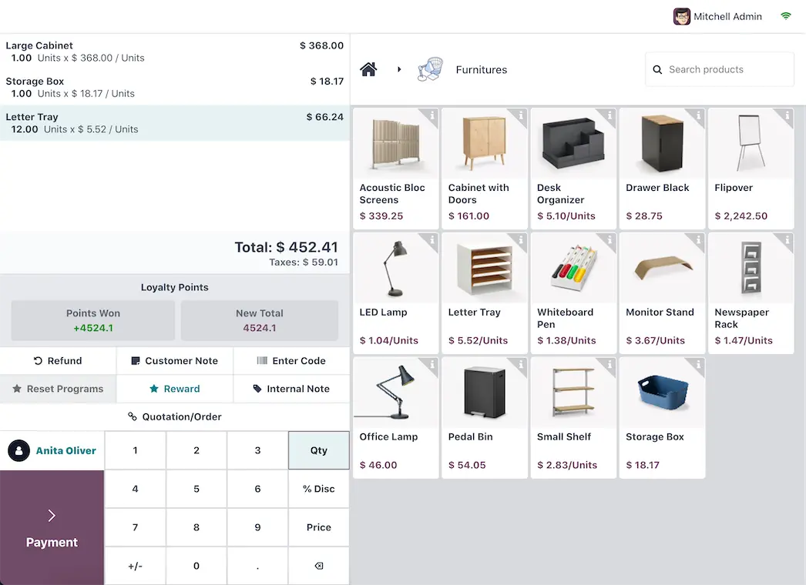
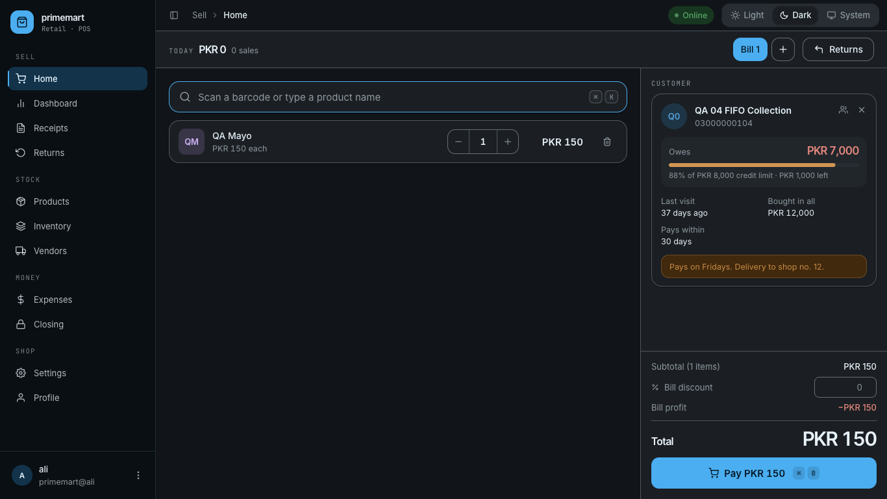
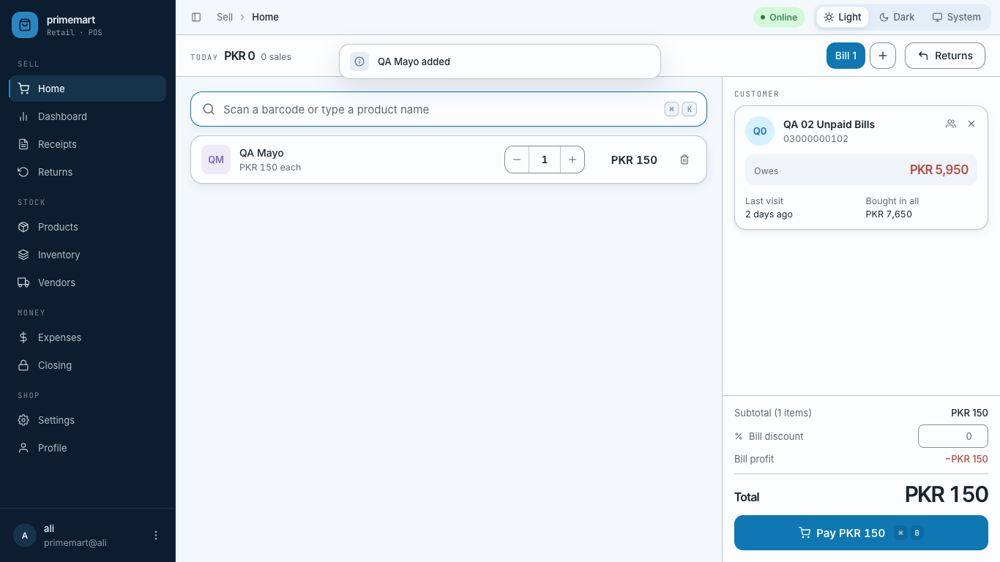
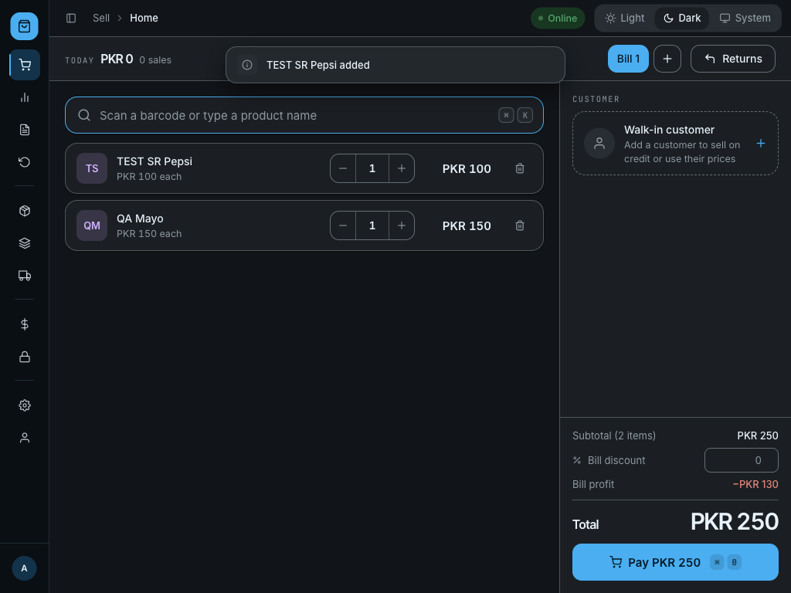

# The till (Home) — research and new design

**What this is:** how four well-known POS apps lay out their sale screen, what we copied and what
we didn't, and the till as it is now built. Each "Decision" box is something for you (or the client)
to say yes or no to.

**Status:** built and tested on the test database (cashier login). Nothing is committed.

---

## 1. The problems with the old screen



| Problem | Why it matters |
|---|---|
| Opening Home showed a grey skeleton of the **whole page** until three server calls finished, one after the other | The till felt slow, even though the search box, cart and Pay button need no server data |
| The right third of the screen was a **"Top sellers" / quick-add grid** | Shops scan or search; the grid took space from the cart and was another server call |
| Totals and Pay were a **full-width band at the bottom** | The cart lost height, so long bills scrolled early |
| Picking a customer showed only **name + phone** in a small chip | The client asked to see the customer's details when they are picked |

---

## 2. What other POS apps do

### Shopify POS (version 10, 2025 redesign)



- The **right-hand panel is the sale**: the customer (initials, name, "12 orders · email") is at the top,
  the items below, and one big **Checkout $71.50** button at the bottom.
- Shopify's own write-up says the redesign is built around "a better cart experience": more line
  items in one view, headers that say what kind of sale it is, and "prominent checkout buttons with
  clear totals".
- The left side is *their* tile grid (shortcuts, discounts, "Add custom sale").

### Lightspeed Retail (X-Series)



- **Search on the left, sale on the right.** The customer field sits **at the top of the sale panel**;
  typing a name shows matching customers with a tag (e.g. "FREE DELIVERY") and their code / phone,
  plus "Add … as a new customer".
- **Pay {n items} $614.99** is one wide button at the bottom of the sale panel.



- Their customer account shows **Balance**, **"Allow on account balance — up to a limit of $1,000"**,
  **Limit available**, **Total spent** and **Last 12 months**. Lightspeed says on-account details can
  be viewed "on the Sell screen during a sale".

### Odoo Point of Sale



- Cart with **Total** on the left, product **photo grid** on the right, the **customer button** next to
  a big **Payment** button. Built for touch screens (number pad on screen).

### Square (no usable screenshot)

Square's help pages say you attach a customer during checkout to see "previous visits, preferences,
frequently purchased items and personalised notes". Their public pages only had marketing photos,
so there is no screenshot here.

### What they all share

1. **Two parts:** what you are selling (left) and **the sale** (right) — customer at the top,
   total + one big pay button at the bottom.
2. The **customer lives in the sale panel**, not in the top bar.
3. Picking a customer **shows who they are** (history, notes, account).

---

## 3. What we built

### With a customer who owes money and has a credit limit (light)


### Same, dark



### A customer without a credit limit or note



### Walk-in, small window (1024 × 768)



### The layout

```
┌──────────────────────────────────────────┬────────────────────────────┐
│ 🔍 Scan a barcode or type a product name │ CUSTOMER                   │
├──────────────────────────────────────────┤ ┌────────────────────────┐ │
│ QA Mayo          − 1 +   PKR 150      🗑 │ │ QA 04 FIFO Collection  │ │
│ TEST SR Pepsi    − 1 +   PKR 100      🗑 │ │ Owes        PKR 7,000  │ │
│                                          │ │ ▓▓▓▓▓▓▓▓░ 88% of 8,000 │ │
│      (the cart uses the full height)     │ │ Last visit · Bought    │ │
│                                          │ │ “Pays on Fridays”      │ │
│                                          │ └────────────────────────┘ │
│                                          │ Subtotal / discount        │
│                                          │ TOTAL         PKR 250      │
│                                          │ [   Pay PKR 250   ⌘0   ]   │
└──────────────────────────────────────────┴────────────────────────────┘
```

### The customer card

Shown the moment a customer is picked, with **no extra server call**. The customer search already
returns all of this.

| Shows | When |
|---|---|
| Initials, name, phone, **Change** and **Remove** buttons | always |
| **Owes PKR …** (red), **Store credit PKR …** (green) or **All paid** | always |
| Credit-limit bar: "88% of PKR 8,000 credit limit · PKR 1,000 left"; amber from 80%, red and "Over the credit limit" past 100% | only if the customer has a credit limit |
| **Last visit** ("today", "yesterday", "37 days ago", or "First visit"), **Bought in all** | always |
| **Pays within N days** | only if credit days are set |
| **Special prices: N products** | only if they have special rates |
| The shop's **note** about the customer (amber box) | only if there is a note |
| **Open their ledger** | only for staff allowed to open Customers |

With no customer: a dashed **"Walk-in customer — Add a customer to sell on credit or use their
prices"** box. Clicking it opens the same search as before.

### Instant loading

| Before | Now |
|---|---|
| Whole page grey until 3 calls finished, **one after the other** | The till shows **at once** (≈ 60 ms in the test) |
| Products, top sellers, today's total | Products and today's total, **at the same time**; top sellers is no longer loaded |
| Every visit to Home loaded everything again | Products and today's figure are **kept in memory**: going back to Home took **62 ms** with everything ready, and they refresh quietly in the background |
| — | While products are still loading, the search box says **"Loading products… you can scan already"** and the "Today" figure shows "—". A barcode scanned in that moment is **kept and added as soon as the products arrive** (tested with a 3-second delay) |

### What did not change

The sale itself: prices, special rates, discounts, stock checks, credit, add-to-bill, payment window,
receipts, scanner guard, shortcuts (⌘/Ctrl K, ⌘/Ctrl 0, Esc). One full cash sale was made with a
customer on the bill to check it.

---

## 4. Decisions for you / the client

> **A. Quick-add grid — removed.** Shopify, Lightspeed and Odoo all keep a product grid, but mainly
> for touch screens and shops without barcodes. Your shops scan. **Keep it removed?** If some shops
> want it back, it can be an on/off setting (it would be loaded only when switched on).

> **B. "Usually buys" on the customer card** — the customer's 3 most-bought items, tap to add
> (Square shows "frequently purchased items"). Needs **one small new server endpoint**; I can write
> the backend prompt. **Yes / no?**

> **C. Warn before selling on credit past the limit.** The card already turns red. The payment window
> could also ask "This takes QA 04 over their limit — continue?" (a warning, not a block).
> **Yes / no?**

> **D. "Today's target" bar (PKR 5,000)** — removed with the quick-add panel. The figure was fixed in
> the code, not set by the shop. **Bring it back as a shop setting, or leave it out?**

---

## Sources

- Shopify — [Shopify POS design update (Version 10)](https://www.shopify.com/blog/shopify-pos-design-update) · [POS UI](https://www.shopify.com/blog/pos-ui)
- Lightspeed — [Managing customers in Retail POS (X-Series)](https://x-series-support.lightspeedhq.com/hc/articles/25534063246235) · [Managing customer credit accounts](https://retail-support.lightspeedhq.com/hc/articles/20656766930459-Managing-customer-credit-accounts)
- Odoo — [Point of Sale for shops](https://www.odoo.com/app/point-of-sale-shop)
- Square — [Customer directory](https://squareup.com/help/us/en/article/5498) · [Get started with your customer directory](https://squareup.com/help/us/en/article/6217)
- KORONA — [8 tips for a fast retail checkout](https://koronapos.com/blog/8-tips-fast-retail-checkout-experience/)

Screenshots of other products are from the pages above. They are kept here for internal reference
only and belong to their owners. Don't ship them in the app or publish them.
